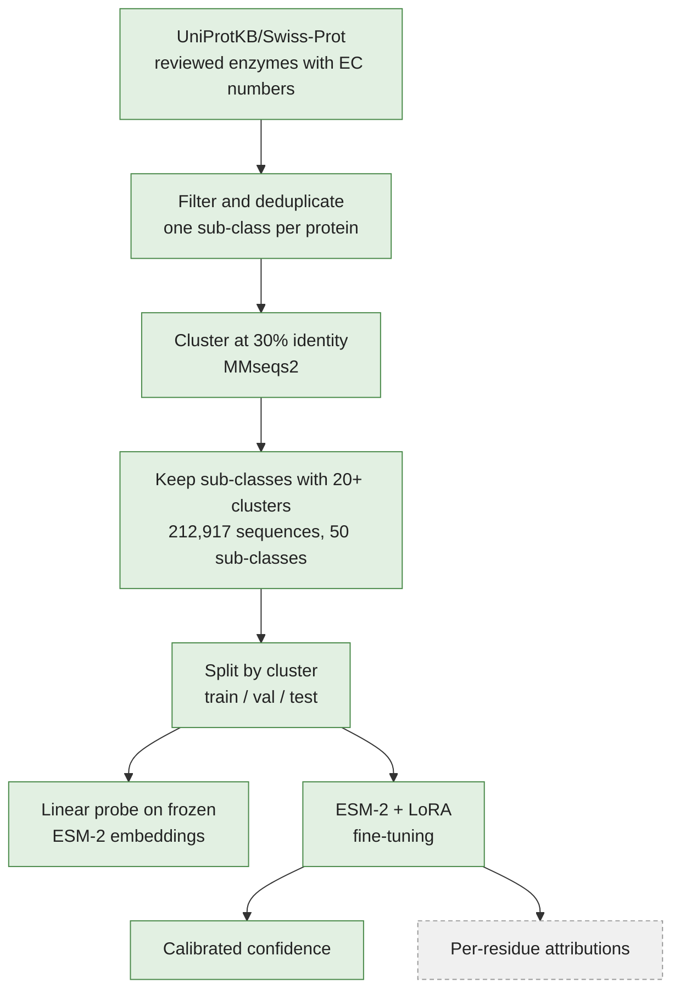
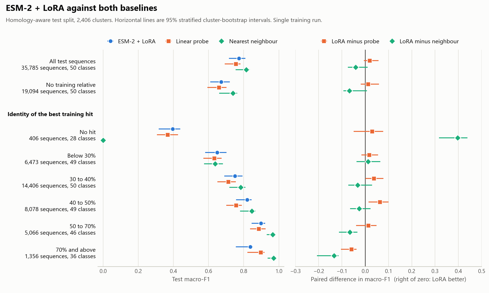
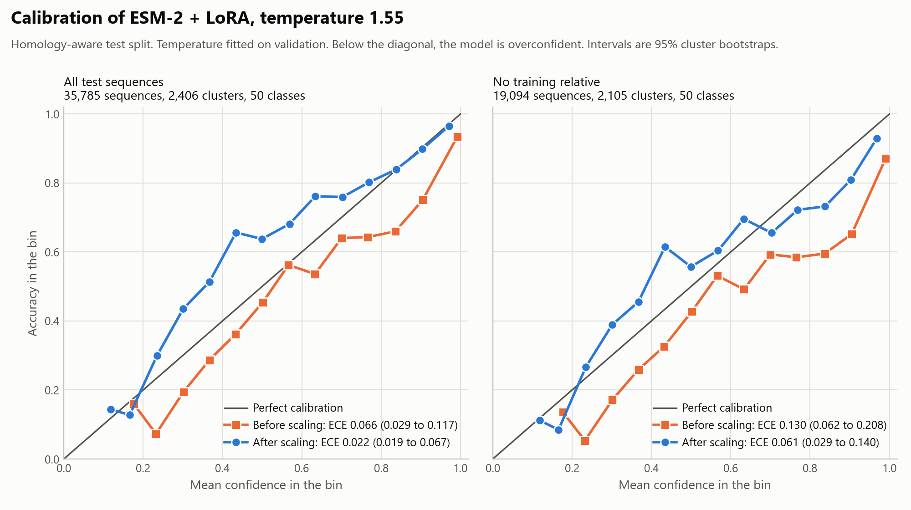

# DecodEC


[](LICENSE)


**Enzyme sub-class prediction from sequence, tested on proteins unlike anything seen in training.**

Give DecodEC an enzyme sequence. It predicts the EC sub-class (for example 3.4, the peptidases), says how confident it is, and shows which residues drove the call. Under the hood it fine-tunes the ESM-2 protein language model with LoRA and evaluates it on homology-aware splits, and measures how close each test protein is to the training set, so a score can be read against that distance.

> **Status: in development.** The data pipeline, both baselines, the fine-tuned model and its calibration work. Attributions and the inference API are not built yet. This README describes what exists today and will grow as each part lands.

## Why

Knowing what an enzyme does is the starting point for target identification, selectivity work and enzyme engineering. Classical tools such as BLAST work well when a close relative with a known function exists. They struggle with remote homologues: proteins that share a mechanism but have drifted too far in sequence to be recognised.

Protein language models learn from millions of natural sequences and may capture function beyond plain similarity. The catch is evaluation. Protein datasets are full of near-duplicates, and a random train/test split lets a model score well by memorising close relatives. DecodEC is built around one question: **how much do protein language models really help once that leakage is removed?**

## How it works



Green steps work today. Grey dashed steps are planned.

A few things worth knowing:

- **The cluster, not the sequence, is the unit of independence.** Sequences are grouped at 30% identity, and every cluster lands in exactly one split. This removes the closest relatives but not all of them, because clustering compares members with a representative, not with each other. A search of test against train measures what remains (see below).
- **Classes are counted in clusters too.** A sub-class stays only if it has at least 20 clusters, and every sub-class gets at least 3 clusters in validation and in test. A class with hundreds of test sequences from two clusters would really be judged on two examples.
- **The label is the EC sub-class**, the first two digits of the EC number. All seven top-level classes are covered, including EC 7 (translocases). Proteins annotated with more than one sub-class (0.4%) are left out, because they have no single correct label.
- **The fine-tuned model is compared with fair baselines** on the same splits: a linear probe on frozen embeddings and a classical sequence-similarity search.

## What works today

| Part | Status |
|---|---|
| Download from UniProtKB/Swiss-Prot with EC filtering and checksums | Built |
| Multi-sub-class filter, deduplication, rare-class filter | Built |
| MMseqs2 clustering, cluster-count class filter and cluster-level splits | Built |
| PyTorch dataset with ESM-2 tokenisation, dynamic padding and length-grouped batches | Built |
| Linear probe on frozen ESM-2 embeddings, with cluster-bootstrap intervals | Built |
| ESM-2 + LoRA training with resumable checkpoints | Built |
| Sequence-similarity baseline and search of test against train | Built |
| Paired comparison of LoRA with both baselines, by identity to train | Built |
| Random vs homology-aware split comparison | Planned |
| Calibration (temperature scaling, ECE), by identity and by cluster | Built |
| Integrated gradients with conservation check | Planned |
| Hybrid of search and language model, with its threshold set on validation | Planned |
| Inference API and Docker image | Planned |
| Tests and CI, run with networking off | Built |

## Current results

Three models on the same homology-aware split (30% identity, 80% coverage), 50 EC sub-classes, 35,785 test sequences in 2,406 clusters.

- **Nearest neighbour:** copy the label of the best training hit from an MMseqs2 search. A sequence with no hit counts as wrong.
- **Linear probe:** logistic regression on frozen, mean-pooled ESM-2 650M embeddings, with class weights and regularisation chosen on validation.
- **ESM-2 + LoRA:** ESM-2 650M with rank-8 LoRA adapters and a linear head on the mean-pooled residues, trained for 3 epochs with class weights. It has 1,415,730 trainable parameters.

<picture>
  <source media="(prefers-color-scheme: dark)" srcset="experiments/model_comparison/results/model_comparison_dark.png">
  
</picture>

In the right panel, an interval that crosses the zero line means no clear difference. Exact values are in the tables below.

| Test macro-F1 (95% CI) | ESM-2 + LoRA | Linear probe | Nearest neighbour | LoRA minus probe | LoRA minus neighbour |
|---|---|---|---|---|---|
| **No training relative** (19,094 sequences, 50 classes) | **0.672 (0.609 to 0.721)** | 0.659 (0.594 to 0.702) | 0.739 (0.660 to 0.762) | **+0.013 (-0.020 to 0.059)** | **-0.067 (-0.094 to 0.008)** |
| All test sequences (35,785 sequences, 50 classes) | 0.773 (0.716 to 0.809) | 0.755 (0.692 to 0.782) | 0.815 (0.754 to 0.835) | +0.019 (-0.006 to 0.057) | -0.041 (-0.075 to 0.010) |

"No training relative" means no training hit at or above 30% identity covering at least 80% of both sequences. This excludes 47% of the test set, because clustering compares members with a representative and so leaves some relatives across the split. Intervals are stratified cluster bootstraps: clusters, not sequences, are resampled within each class, and differences are paired on the same clusters.

**Fine-tuning did not clearly beat either baseline.** Every interval above for LoRA minus a baseline includes zero. The nearest neighbour does clearly beat the frozen probe: by 0.080 (0.009 to 0.110) with no training relative, and by 0.060 (0.013 to 0.100) on all test sequences.

Performance by identity of the best training hit:

| Best-hit identity | Sequences | Clusters | Classes | LoRA macro-F1 | Probe macro-F1 | Neighbour macro-F1 | LoRA minus probe | LoRA minus neighbour |
|---|---|---|---|---|---|---|---|---|
| No hit | 406 | 117 | 28 | 0.397 | 0.367 | 0.000 | +0.029 (-0.050 to 0.077) | +0.397 (0.317 to 0.439) |
| Below 30% | 6,473 | 965 | 49 | 0.649 | 0.632 | 0.637 | +0.017 (-0.016 to 0.056) | +0.012 (-0.037 to 0.065) |
| 30 to 40% | 14,406 | 1,212 | 50 | 0.750 | 0.712 | 0.783 | +0.038 (0.001 to 0.078) | -0.033 (-0.073 to 0.029) |
| 40 to 50% | 8,078 | 684 | 49 | 0.820 | 0.757 | 0.846 | +0.063 (0.014 to 0.100) | -0.026 (-0.065 to 0.023) |
| 50 to 70% | 5,066 | 449 | 46 | 0.898 | 0.885 | 0.965 | +0.013 (-0.039 to 0.049) | -0.066 (-0.113 to -0.033) |
| 70% and above | 1,356 | 175 | 36 | 0.837 | 0.897 | 0.971 | -0.060 (-0.104 to -0.038) | -0.133 (-0.208 to -0.115) |

The subset and bins were fixed before any per-bin score was computed. Bins hold different sets of classes, so macro-F1 is not strictly comparable between rows; the difference within a row is the comparison to read. The six rows are six comparisons with no correction for multiplicity, so an interval that barely excludes zero is weak evidence.

What the numbers say:

- **Similarity wins while it has something to work with.** With a hit at 50% identity or above, the neighbour beats LoRA clearly. For weaker hits, the intervals include zero.
- **Language models help where the search finds nothing, and fine-tuning is not the reason.** With no hit, the neighbour scores 0.000, and LoRA and the frozen probe score about the same. That group is small, about 1% of the test set.
- **Fine-tuning may help at middle identities.** LoRA is ahead of the probe from 30 to 50% identity, most clearly from 40 to 50%. This needs repeating before it counts as a finding.
- **LoRA is worse than the frozen probe at 70% identity and above, mostly because of one family.** All 204 test sequences of one cluster, spider and scorpion dermonecrotic toxins (EC 4.6), are predicted as EC 3.1, and 103 of them fall in this bin. Training holds only two sequences of this family, fragments of 71 and 161 residues that LoRA gets right, while the test sequences are 263 to 324 residues long. Their high identity covers only about 57% of each sequence, so the bin is not made up only of close full-length relatives. This was found after seeing the results, so it is exploratory and the tables above keep the cluster. Without it, accuracy in this bin is 0.953 for LoRA and 0.948 for the probe, and the macro-F1 difference shrinks to -0.024 (-0.070 to -0.001) on 1,253 sequences, 35 classes.
- **These are single runs on one split,** so the intervals cover which test clusters were drawn, not training or split randomness.
- **Exploratory, chosen after seeing the data:** on the 7.8% of sequences with a weak hit or none (E-value above 0.001), the probe beats the neighbour by 0.222 (0.183 to 0.297). A hybrid that trusts the search when its hit is strong and the probe otherwise scores 0.780 on sequences with no training relative, 0.041 (0.022 to 0.078) above the neighbour alone. Both need confirming with a threshold set on validation data.

### Calibration

Before calibration, the model is overconfident: on all test sequences its mean confidence is 0.943 and its accuracy is 0.877. Temperature scaling divides the logits by one number, fitted on validation, here **T = 1.55**. No prediction changes, so accuracy and macro-F1 stay as above.

<picture>
  <source media="(prefers-color-scheme: dark)" srcset="experiments/calibration/results/reliability_dark.png">
  
</picture>

Expected calibration error (ECE), the average gap between confidence and accuracy, on the same test split. Lower is better:

| Test sequences | Sequences | Clusters | Classes | ECE before | ECE after | Change (paired) |
|---|---|---|---|---|---|---|
| **All** | 35,785 | 2,406 | 50 | 0.066 (0.029 to 0.117) | 0.022 (0.019 to 0.067) | -0.044 (-0.061 to 0.020) |
| **No training relative** | 19,094 | 2,105 | 50 | 0.130 (0.062 to 0.208) | 0.061 (0.029 to 0.140) | -0.068 (-0.087 to -0.013) |
| No hit | 406 | 117 | 28 | 0.250 (0.176 to 0.357) | 0.135 (0.089 to 0.225) | -0.115 (-0.148 to -0.057) |
| Below 30% | 6,473 | 965 | 49 | 0.134 (0.059 to 0.234) | 0.066 (0.030 to 0.168) | -0.068 (-0.090 to -0.013) |
| 30 to 40% | 14,406 | 1,212 | 50 | 0.086 (0.027 to 0.164) | 0.048 (0.022 to 0.118) | -0.039 (-0.065 to 0.029) |
| 40 to 50% | 8,078 | 684 | 49 | 0.009 (0.006 to 0.030) | 0.073 (0.047 to 0.102) | +0.064 (0.020 to 0.090) |
| 50 to 70% | 5,066 | 449 | 46 | 0.009 (0.005 to 0.026) | 0.060 (0.043 to 0.082) | +0.051 (0.021 to 0.072) |
| 70% and above | 1,356 | 175 | 36 | 0.094 (0.054 to 0.165) | 0.086 (0.079 to 0.141) | -0.008 (-0.035 to 0.053) |

What the numbers say:

- **One temperature is a compromise.** It clearly helps on distant sequences, where the model is most overconfident. From 40 to 70% identity the model was already well calibrated, and scaling makes it underconfident there. On all test sequences the interval for the change includes zero.
- **Confidence is more useful after scaling.** Predictions at 0.9 or above cover 65.0% of test sequences at 96.2% accuracy, against 87.4% at 92.9% before.
- **Whole families can still fail with high confidence.** Of the 239 test clusters with at least 20 sequences, 15 (2,071 sequences) are mostly wrong with a mean confidence of 0.8 or above before scaling, and 8 (1,484 sequences) after. The others mostly just fall below that line: the toxin cluster above stays at 0% accuracy, with mean confidence moving from 0.91 to 0.78. A high score is not a guarantee for a family with little support in training.

The first version of the probe scored 0.494 on an earlier dataset (59 sub-classes, untuned, CLS token). The numbers are not comparable, because the class set and the split changed as well as the probe. That run is kept in [`e0_previous_split/`](experiments/baseline_linear_probe/e0_previous_split/).

The dataset: 149,052 training, 28,080 validation and 35,785 test sequences from 15,728 clusters. Each split holds about 15% of the clusters; the sequence counts differ because cluster sizes vary. Full numbers: [LoRA against both baselines](experiments/model_comparison/results/results.json), [LoRA training](experiments/lora/r8_650M/results.json), [calibration](experiments/calibration/results/results.json), [probe](experiments/baseline_linear_probe/results/results.json), [neighbour](experiments/baseline_similarity/results/results.json), [identity search](experiments/baseline_similarity/results/identity_report.json).

## Quick start

You need Python 3.11, [uv](https://docs.astral.sh/uv/), Docker (MMseqs2 runs in a container) and a CUDA GPU for the baseline.

```bash
git clone https://github.com/izgys/decodec
cd decodec
uv sync --extra dev
```

Build the dataset. The three steps download Swiss-Prot, clean it and split it by cluster:

```bash
uv run python -m src.data.download
uv run python -m src.data.preprocess
uv run python -m src.data.clustering
```

Every setting lives in `config/data.yaml`. Change one for a single run with `--set`, for example a different split seed:

```bash
uv run python -m src.data.clustering --set data.clustering.seed=7
```

A misspelled setting is rejected with an error, so a typo cannot silently do nothing.

Each stage is logged to a local [MLflow](https://mlflow.org/) store with its full settings, the git commit and its report, so every dataset can be traced back to the code and config that built it. Browse the runs with:

```bash
uv run mlflow ui --backend-store-uri sqlite:///mlruns/mlflow.db    # then open http://127.0.0.1:5000
```

Turn tracking off for one run with `--set tracking.enabled=false`.

Then run the baseline in two steps. The first extracts frozen ESM-2 embeddings on the GPU (about 1 hour 40 minutes on a laptop RTX 4070) and can be resumed if interrupted. The second fits the linear probe on the CPU (about 6 minutes):

```bash
uv run python -m src.embeddings
uv run python experiments/baseline_linear_probe/run_probe.py
```

The similarity baseline searches test against train with MMseqs2 (about 3 minutes, Docker needed), then scores both models by identity to the training set:

```bash
uv run python -m src.data.identity
uv run python experiments/baseline_similarity/run_similarity.py
```

Train ESM-2 + LoRA (about 12 hours on a laptop RTX 4070). Rerun the same command to continue after any interruption. The hardware test first takes a few minutes per setting and reports memory use and the estimated run time:

```bash
uv run python -m src.training.benchmark
uv run python -m src.training.trainer --set training.max_tokens=2048 --set training.grad_accum_steps=8
```

Then compare it with both baselines on the same sequences (about a minute) and draw the figure:

```bash
uv run python experiments/model_comparison/run_comparison.py
uv run python -m src.visualisation.comparison_figure
```

Calibrate it from the saved logits (under a minute, no GPU needed) and draw the reliability diagram:

```bash
uv run python -m src.calibration.temperature
uv run python -m src.visualisation.reliability_figure
```

Results land in each experiment's folder (`results.json` and per-class reports) and in MLflow. UniProt changes with every release, so a fresh download will give slightly different numbers.

## Design choices

**Sub-classes, not top-level classes.** Seven top-level classes make the task too easy to learn much from. Sub-classes are harder and still leave enough sequences for most classes.

**Homology-aware splits first, random splits only as a comparison.** A random split mostly tests memory. The gap between the two will be measured directly on the same data, with nothing else changed.

**A fair baseline before fine-tuning.** If the baseline is weak, any fine-tuned model looks good. The linear probe gets tuned before it is used as the reference.

**LoRA instead of full fine-tuning.** LoRA freezes ESM-2 and trains small low-rank updates on top. It needs far less GPU memory and keeps what the model learned in pre-training.

**Temperature scaling for calibration.** One parameter, fitted on validation data. It cannot change which class is predicted, only how confident the prediction is, which makes it easy to check and explain.

**Integrated gradients, not attention weights.** Attention shows how information flows through the model, not which residues matter. Integrated gradients give per-residue attributions that can be checked against conservation in multiple sequence alignments.

## Known limitations

Each limitation has a planned fix.

| Limitation | Example | Planned fix |
|---|---|---|
| The split leaves relatives across train and test | 47% of test sequences have a training sequence above 30% identity and 80% coverage; they are scored separately, not removed | Measure what a stricter partitioning would cost |
| The interval covers test clusters only | One fitted model on one fixed split, and one training run for LoRA | Repeat over several split and training seeds |
| Whole families can fail with high confidence | 8 of 239 large test clusters are mostly wrong at a mean confidence of 0.8 or above, even after calibration; all 204 dermonecrotic toxins (EC 4.6) are predicted as EC 3.1 | Flag low training support at inference, for example with the best hit from a sequence search |
| One temperature does not fit every identity range | After scaling, ECE is 0.066 below 30% identity and 0.073 from 40 to 50%, in opposite directions | Test a temperature that depends on identity to the training set |
| Multi-functional enzymes are left out | 1,003 proteins (0.4%) have EC numbers in more than one sub-class | Multi-label classification in v3 |
| The rarest sub-classes are not covered | 25 sub-classes have fewer than 100 sequences or 20 clusters, for example EC 7.3 and 7.4 | Listed with their counts; revisited as UniProt grows |
| Leakage gap not yet measured | Only the homology-aware split has been run | Random split on the same records, everything else unchanged |
| MMseqs2 version not pinned | The Docker image uses the `latest` tag | Pin the version and store checksums for every pipeline stage |
| Low confidence is a weak signal for unknown families | Families absent from Swiss-Prot cannot be predicted correctly | Calibrated low-confidence flag, documented as a limit rather than a detector |

## Roadmap

**v1: sequence-based classification**

- [x] Data pipeline: download, filtering, deduplication, label encoding
- [x] Homology-aware splitting with MMseqs2
- [x] First linear probe on frozen ESM-2 embeddings
- [x] Evaluable-class rule: at least 20 clusters per sub-class, at least 3 in validation and test
- [x] Dynamic padding and length-grouped batches for training
- [x] Corrected baseline on the current dataset, with cluster-bootstrap intervals
- [x] Sequence-similarity baseline, and performance by identity to the training set
- [x] ESM-2 650M + LoRA fine-tuning, tracked in MLflow
- [x] Paired comparison of LoRA with both baselines, by identity to the training set
- [x] Calibration with ECE and reliability diagrams
- [x] Tests and CI, run with networking off
- [ ] Random vs homology-aware split comparison
- [ ] Hybrid of search and language model, with its threshold set on validation
- [ ] Integrated gradients with a conservation cross-check, on selected families and failing clusters
- [ ] Inference API and Docker image, returning the prediction with its evidence: best hit, identity, calibrated confidence and a low-support flag
- [ ] Release v1 with its results as they stand

**v2: improving the model**

The goal is to beat the nearest neighbour on sequences with no training relative (macro-F1 0.739 (0.660 to 0.762) on the current test split, 19,094 sequences, 50 classes). The current test set has been used, so the rules are fixed before any tuning:

- [ ] Fix a new holdout, from a new split seed or newer Swiss-Prot entries, and score the nearest neighbour on it
- [ ] Set the success rule: the interval for the paired difference must exclude zero
- [ ] Set a limit on full training runs, with settings chosen on validation and one final test evaluation
- [ ] Try reducing overfitting, different class weighting, attention pooling and contrastive learning
- [ ] Report the result, whichever way it goes

**v3: structure-aware extension**

- [ ] Attributions mapped onto 3D structures
- [ ] Structure-aware tokens (SaProt)
- [ ] Multi-label classification for multi-functional enzymes
- [ ] Newer protein language models

## For developers

<details>
<summary><b>Repository structure</b></summary>

```text
decodec/
├── config/
│   ├── config.yaml               root config (Hydra), lists the groups below
│   ├── data.yaml                 UniProt query, filters, clustering settings
│   ├── embeddings.yaml           ESM-2 model and batching for embedding extraction
│   ├── lora.yaml                 LoRA rank, alpha, target modules
│   ├── training.yaml             training settings and hardware test
│   ├── probe.yaml                linear probe: poolings, C grid, class weights
│   ├── similarity.yaml           no-relative subset and identity bins
│   ├── comparison.yaml           LoRA vs baselines: predictions and bootstrap settings
│   ├── calibration.yaml          temperature scaling: bins, thresholds, cluster check
│   └── tracking.yaml             MLflow on/off and store folder
├── src/
│   ├── config.py                 loads config/ and --set overrides
│   ├── tracking.py               MLflow logging (SQLite store in mlruns/)
│   ├── metrics.py                macro-F1, cluster bootstrap, hierarchical metrics
│   ├── embeddings.py             frozen ESM-2 embeddings (CLS and mean) per split
│   ├── data/
│   │   ├── download.py           UniProt download with EC filtering
│   │   ├── preprocess.py         multi-sub-class filter, deduplication, rare-class filter
│   │   ├── clustering.py         MMseqs2 clustering, class filter, splits, label map
│   │   ├── identity.py           MMseqs2 search of test against train
│   │   └── dataset.py            ESM-2 tokenisation, dynamic padding, length-grouped batches
│   ├── model/esm2_lora.py        ESM-2 + LoRA with a mean-pooling head
│   ├── training/
│   │   ├── trainer.py            training loop, checkpoints, automatic resume
│   │   └── benchmark.py          hardware test: memory, speed, estimated run time
│   ├── calibration/temperature.py   temperature scaling, ECE, per-view and per-cluster checks
│   ├── visualisation/            README figures from the saved results
│   └── interpretability/, inference/
│                                 placeholders for the planned parts
├── tests/                        offline tests, run in CI with networking off
├── data/                         created by the pipeline, not tracked (except checksums.json)
├── experiments/
│   ├── baseline_linear_probe/    linear probe on frozen embeddings (e0_previous_split/: first, historical run)
│   ├── baseline_similarity/      nearest neighbour vs probe, by identity to train
│   ├── lora/                     hardware test, 35M trial and 650M training results
│   ├── model_comparison/         LoRA vs both baselines, by identity to train
│   └── calibration/              temperature, ECE before and after, reliability diagrams
├── pyproject.toml
└── uv.lock
```

</details>

<details>
<summary><b>Pipeline settings</b></summary>

All data settings live in `config/data.yaml`, under the `data` key (so `--set data.filtering.min_class_count=50`):

| Setting | Value | What it controls |
|---|---|---|
| `uniprot.query` | `reviewed:true AND ec:*` | Swiss-Prot entries with at least one EC number |
| `filtering.min_length` / `max_length` | 50 / 1024 | Sequence length range |
| `filtering.min_ec_digits` | 2 | EC numbers must be specific to the sub-class |
| `filtering.min_class_count` | 100 | Sub-classes with fewer sequences are dropped |
| `clustering.min_seq_id` | 0.30 | Identity threshold for clustering |
| `clustering.min_clusters_per_class` | 20 | Sub-classes with fewer clusters are dropped |
| `clustering.min_eval_clusters` | 3 | Guaranteed clusters per sub-class in validation and in test |
| `clustering.train_frac` / `val_frac` | 0.70 / 0.15 | Share of clusters per split; the rest is test |
| `clustering.seed` | 42 | Makes the split reproducible |

</details>

## References

**Data and tools**

- The UniProt Consortium (2025). UniProt: the Universal Protein Knowledgebase in 2025. *Nucleic Acids Res.* 53:D609-D617. [doi:10.1093/nar/gkae1010](https://doi.org/10.1093/nar/gkae1010)
- Steinegger M, Söding J (2017). MMseqs2 enables sensitive protein sequence searching for the analysis of massive data sets. *Nat. Biotechnol.* 35:1026-1028. [doi:10.1038/nbt.3988](https://doi.org/10.1038/nbt.3988)
- Steinegger M, Söding J (2018). Clustering huge protein sequence sets in linear time. *Nat. Commun.* 9:2542. [doi:10.1038/s41467-018-04964-5](https://doi.org/10.1038/s41467-018-04964-5)

**Models and methods**

- Lin Z et al. (2023). Evolutionary-scale prediction of atomic-level protein structure with a language model. *Science* 379:1123-1130. [doi:10.1126/science.ade2574](https://doi.org/10.1126/science.ade2574)
- Hu EJ et al. (2022). LoRA: Low-Rank Adaptation of Large Language Models. *ICLR*. [arXiv:2106.09685](https://arxiv.org/abs/2106.09685)
- Guo C et al. (2017). On Calibration of Modern Neural Networks. *ICML*. [arXiv:1706.04599](https://arxiv.org/abs/1706.04599)
- Sundararajan M, Taly A, Yan Q (2017). Axiomatic Attribution for Deep Networks. *ICML*. [arXiv:1703.01365](https://arxiv.org/abs/1703.01365)
- Rao R et al. (2021). MSA Transformer. *ICML*.
- Su J et al. (2024). SaProt: Protein Language Modeling with Structure-aware Vocabulary. *ICLR*. [doi:10.1101/2023.10.01.560349](https://doi.org/10.1101/2023.10.01.560349) (preprint)

## Author

**Iker Zapirain Gysling**  
Computational Biochemist, PhD  
Barcelona, Spain  
[LinkedIn](https://linkedin.com/in/zgysling) · [GitHub](https://github.com/izgys)

## License

MIT License. See [`LICENSE`](LICENSE) for details.
