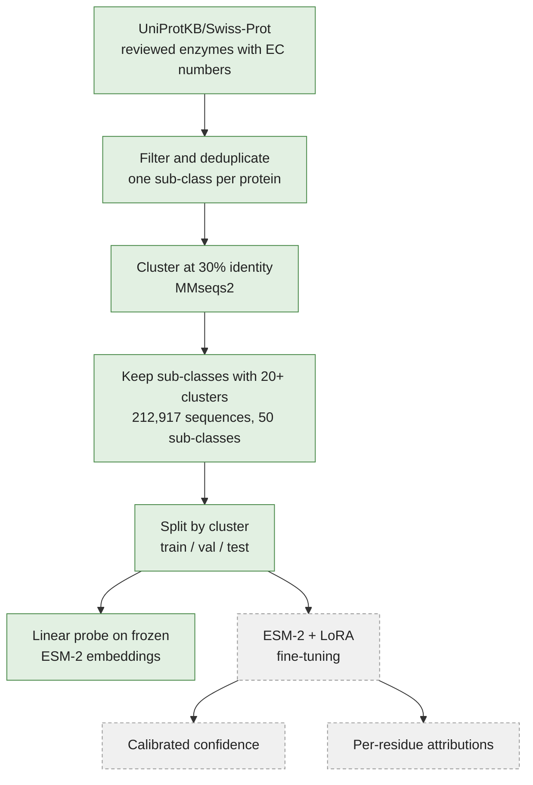

# DecodEC


[](LICENSE)


**Enzyme sub-class prediction from sequence, tested on proteins unlike anything seen in training.**

Give DecodEC an enzyme sequence. It predicts the EC sub-class (for example 3.4, the peptidases), says how confident it is, and shows which residues drove the call. Under the hood it fine-tunes the ESM-2 protein language model with LoRA and evaluates it on homology-aware splits, so the score reflects new proteins rather than close relatives of the training set.

> **Status: early development.** The data pipeline and a first baseline work. The fine-tuned model, calibration, attributions and the inference API are not built yet. This README describes what exists today and will grow as each part lands.

## Why

Knowing what an enzyme does is the starting point for target identification, selectivity work and enzyme engineering. Classical tools such as BLAST work well when a close relative with a known function exists. They struggle with remote homologues: proteins that share a mechanism but have drifted too far in sequence to be recognised.

Protein language models learn from millions of natural sequences and may capture function beyond plain similarity. The catch is evaluation. Protein datasets are full of near-duplicates, and a random train/test split lets a model score well by memorising close relatives. DecodEC is built around one question: **how much do protein language models really help once that leakage is removed?**

## How it works



Green steps work today. Grey dashed steps are planned.

A few things worth knowing:

- **The cluster, not the sequence, is the unit of independence.** Sequences are grouped at 30% identity, and every cluster lands in exactly one split. No test protein has a close relative in training.
- **Classes are counted in clusters too.** A sub-class stays only if it has at least 20 clusters, and every sub-class gets at least 3 clusters in validation and in test. A class with hundreds of test sequences from two clusters would really be judged on two examples.
- **The label is the EC sub-class**, the first two digits of the EC number. All seven top-level classes are covered, including EC 7 (translocases). Proteins annotated with more than one sub-class (0.4%) are left out, because they have no single correct label.
- **Every fine-tuning result will be compared with fair baselines** on the same splits: a linear probe on frozen embeddings and a classical sequence-similarity search.

## What works today

| Part | Status |
|---|---|
| Download from UniProtKB/Swiss-Prot with EC filtering and checksums | Built |
| Multi-sub-class filter, deduplication, rare-class filter | Built |
| MMseqs2 clustering, cluster-count class filter and cluster-level splits | Built |
| PyTorch dataset with ESM-2 tokenisation, dynamic padding and length-grouped batches | Built |
| Linear probe on frozen ESM-2 embeddings | Built, preliminary (previous dataset version) |
| ESM-2 + LoRA fine-tuning | Planned |
| Sequence-similarity baseline | Planned |
| Random vs homology-aware split comparison | Planned |
| Calibration (temperature scaling, ECE) | Planned |
| Integrated gradients with conservation check | Planned |
| Inference API, Docker image, tests and CI | Planned |

## First result

| Model | Classes | Split | Test macro-F1 | Test micro-F1 |
|---|---|---|---|---|
| Linear probe on frozen ESM-2 650M embeddings | 59 EC sub-classes | Homology-aware (30% identity, 80% coverage) | 0.494 | 0.679 |

**This result comes from the previous version of the dataset** (216,962 sequences, 59 sub-classes) and cannot be compared with anything run on the current one. It is kept because it showed what had to change:

- **Some classes were too small to score.** EC 2.9 had no test sequences and EC 1.9 had one, yet both counted as F1 = 0 in the macro average. The pipeline now counts classes in clusters, which removed 9 more sub-classes and guarantees at least 3 clusters per class in validation and test.
- **It is a single run with no uncertainty estimate.**
- **The probe was not tuned.** It used the CLS token, cut sequences at 512 residues and had no class weighting. On several rare classes it was always right when it predicted them but almost never predicted them (EC 1.15: precision 1.00, recall 0.05).

The current dataset: 149,052 training, 28,080 validation and 35,785 test sequences from 15,728 clusters, in 50 sub-classes. Each split holds about 15% of the clusters; the sequence counts differ because cluster sizes vary.

A corrected baseline on this dataset comes next, before any fine-tuning result, so that the gain from fine-tuning is measured against a fair starting point.

## Quick start

You need Python 3.11, [uv](https://docs.astral.sh/uv/), Docker (MMseqs2 runs in a container) and a CUDA GPU for the baseline.

```bash
git clone https://github.com/izgys/decodec
cd decodec
uv sync --extra dev
```

Build the dataset. The three steps download Swiss-Prot, clean it and split it by cluster:

```bash
uv run python -m src.data.download --config config/data_config.yaml
uv run python -m src.data.preprocess --config config/data_config.yaml
uv run python -m src.data.clustering --config config/data_config.yaml
```

Then run the baseline:

```bash
uv run python experiments/baseline_zeroshot/run_baseline.py
```

Results land in `experiments/baseline_zeroshot/` (`results.json` and a per-class report). UniProt changes with every release, so a fresh download will give slightly different numbers.

## Design choices

**Sub-classes, not top-level classes.** Seven top-level classes make the task too easy to learn much from. Sub-classes are harder and still leave enough sequences for most classes.

**Homology-aware splits first, random splits only as a comparison.** A random split mostly tests memory. The gap between the two will be measured directly on the same data, with nothing else changed.

**A fair baseline before fine-tuning.** If the baseline is weak, any fine-tuned model looks good. The linear probe gets tuned before it is used as the reference.

**LoRA instead of full fine-tuning.** LoRA freezes ESM-2 and trains small low-rank updates on top. It needs far less GPU memory and keeps what the model learned in pre-training.

**Temperature scaling for calibration.** One parameter, fitted on validation data. It cannot change which class is predicted, only how confident the prediction is, which makes it easy to check and explain.

**Integrated gradients, not attention weights.** Attention shows how information flows through the model, not which residues matter. Integrated gradients give per-residue attributions that can be checked against conservation in multiple sequence alignments.

## Known limitations

Each limitation has a planned fix.

| Limitation | Example | Planned fix |
|---|---|---|
| The baseline probe is untuned | CLS token, 512-residue cut-off, no class weights; EC 1.15 recall 0.05 | Mean pooling, full length, class weights, regularisation tuned on validation |
| No uncertainty on the headline number | One test macro-F1 from one run | Bootstrap confidence interval over clusters |
| Multi-functional enzymes are left out | 1,003 proteins (0.4%) have EC numbers in more than one sub-class | Multi-label classification in v2 |
| The rarest sub-classes are not covered | 25 sub-classes have fewer than 100 sequences or 20 clusters, for example EC 7.3 and 7.4 | Listed with their counts; revisited as UniProt grows |
| No classical baseline yet | Only the embedding probe exists | Nearest-neighbour sequence search against the training set |
| Leakage gap not yet measured | Only the homology-aware split has been run | Random split on the same records, everything else unchanged |
| MMseqs2 version not pinned | The Docker image uses the `latest` tag | Pin the version and store checksums for every pipeline stage |
| Low confidence is a weak signal for unknown families | Families absent from Swiss-Prot cannot be predicted correctly | Calibrated low-confidence flag, documented as a limit rather than a detector |

## Roadmap

**v1: sequence-based classification**

- [x] Data pipeline: download, filtering, deduplication, label encoding
- [x] Homology-aware splitting with MMseqs2
- [x] First linear probe on frozen ESM-2 embeddings
- [x] Evaluable-class rule: at least 20 clusters per sub-class, at least 3 in validation and test
- [x] Dynamic padding and length-grouped batches for training
- [ ] Corrected baseline on the current dataset
- [ ] Sequence-similarity baseline
- [ ] ESM-2 650M + LoRA fine-tuning, tracked in MLflow
- [ ] Performance against identity to the training set, including random vs homology-aware splits
- [ ] Calibration with ECE and reliability diagrams
- [ ] Integrated gradients with a conservation cross-check
- [ ] Inference API, Docker image, tests and CI

**v2: structure-aware extension**

- [ ] Attributions mapped onto 3D structures
- [ ] Structure-aware tokens (SaProt)
- [ ] Multi-label classification for multi-functional enzymes
- [ ] Newer protein language models

## For developers

<details>
<summary><b>Repository structure</b></summary>

```text
decodec/
├── config/
│   └── data_config.yaml          UniProt query, filters, clustering settings
├── src/
│   ├── data/
│   │   ├── download.py           UniProt download with EC filtering
│   │   ├── preprocess.py         multi-sub-class filter, deduplication, rare-class filter
│   │   ├── clustering.py         MMseqs2 clustering, class filter, splits, label map
│   │   └── dataset.py            ESM-2 tokenisation, dynamic padding, length-grouped batches
│   └── model/, training/, calibration/, interpretability/, inference/, visualisation/
│                                 placeholders for the planned parts
├── data/                         created by the pipeline, not tracked (except checksums.json)
├── experiments/
│   └── baseline_zeroshot/        first linear probe: script, results, per-class report
├── pyproject.toml
└── uv.lock
```

</details>

<details>
<summary><b>Pipeline settings</b></summary>

All data settings live in `config/data_config.yaml`:

| Setting | Value | What it controls |
|---|---|---|
| `uniprot.query` | `reviewed:true AND ec:*` | Swiss-Prot entries with at least one EC number |
| `filtering.min_length` / `max_length` | 50 / 1024 | Sequence length range |
| `filtering.min_ec_digits` | 2 | EC numbers must be specific to the sub-class |
| `filtering.min_class_count` | 100 | Sub-classes with fewer sequences are dropped |
| `clustering.min_seq_id` | 0.30 | Identity threshold for clustering |
| `clustering.min_clusters_per_class` | 20 | Sub-classes with fewer clusters are dropped |
| `clustering.min_eval_clusters` | 3 | Guaranteed clusters per sub-class in validation and in test |
| `clustering.train_frac` / `val_frac` | 0.70 / 0.15 | Share of clusters per split; the rest is test |
| `clustering.seed` | 42 | Makes the split reproducible |

</details>

## References

**Data and tools**

- The UniProt Consortium (2025). UniProt: the Universal Protein Knowledgebase in 2025. *Nucleic Acids Res.* 53:D609-D617. [doi:10.1093/nar/gkae1010](https://doi.org/10.1093/nar/gkae1010)
- Steinegger M, Söding J (2017). MMseqs2 enables sensitive protein sequence searching for the analysis of massive data sets. *Nat. Biotechnol.* 35:1026-1028. [doi:10.1038/nbt.3988](https://doi.org/10.1038/nbt.3988)
- Steinegger M, Söding J (2018). Clustering huge protein sequence sets in linear time. *Nat. Commun.* 9:2542. [doi:10.1038/s41467-018-04964-5](https://doi.org/10.1038/s41467-018-04964-5)

**Models and methods**

- Lin Z et al. (2023). Evolutionary-scale prediction of atomic-level protein structure with a language model. *Science* 379:1123-1130. [doi:10.1126/science.ade2574](https://doi.org/10.1126/science.ade2574)
- Hu EJ et al. (2022). LoRA: Low-Rank Adaptation of Large Language Models. *ICLR*. [arXiv:2106.09685](https://arxiv.org/abs/2106.09685)
- Guo C et al. (2017). On Calibration of Modern Neural Networks. *ICML*. [arXiv:1706.04599](https://arxiv.org/abs/1706.04599)
- Sundararajan M, Taly A, Yan Q (2017). Axiomatic Attribution for Deep Networks. *ICML*. [arXiv:1703.01365](https://arxiv.org/abs/1703.01365)
- Rao R et al. (2021). MSA Transformer. *ICML*.
- Su J et al. (2024). SaProt: Protein Language Modeling with Structure-aware Vocabulary. *ICLR*. [doi:10.1101/2023.10.01.560349](https://doi.org/10.1101/2023.10.01.560349) (preprint)

## Author

**Iker Zapirain Gysling**  
Computational Biochemist, PhD  
Barcelona, Spain  
[LinkedIn](https://linkedin.com/in/zgysling) · [GitHub](https://github.com/izgys)

## License

MIT License. See [`LICENSE`](LICENSE) for details.
